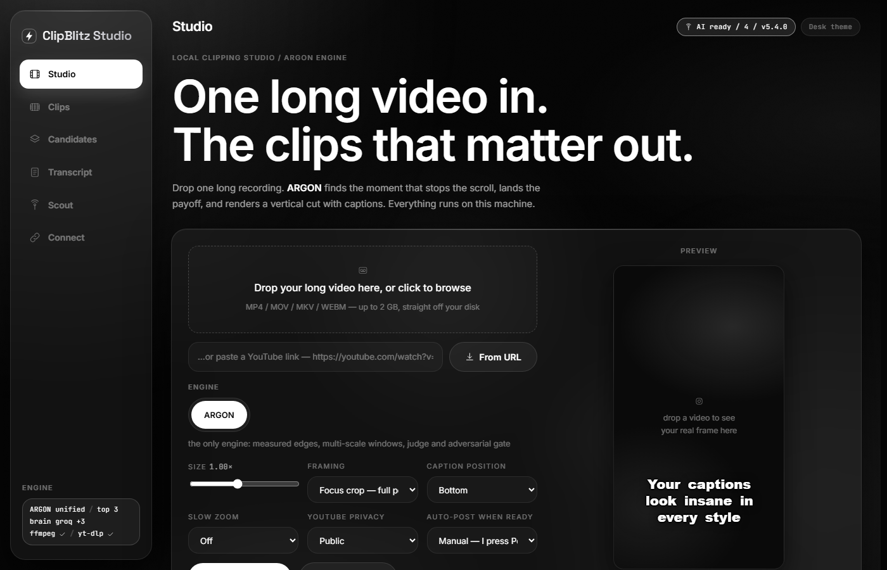
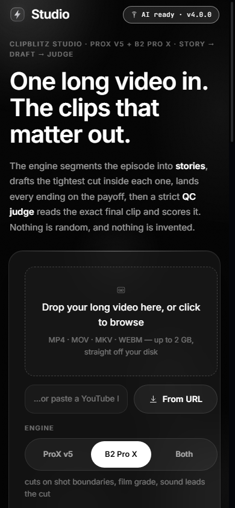
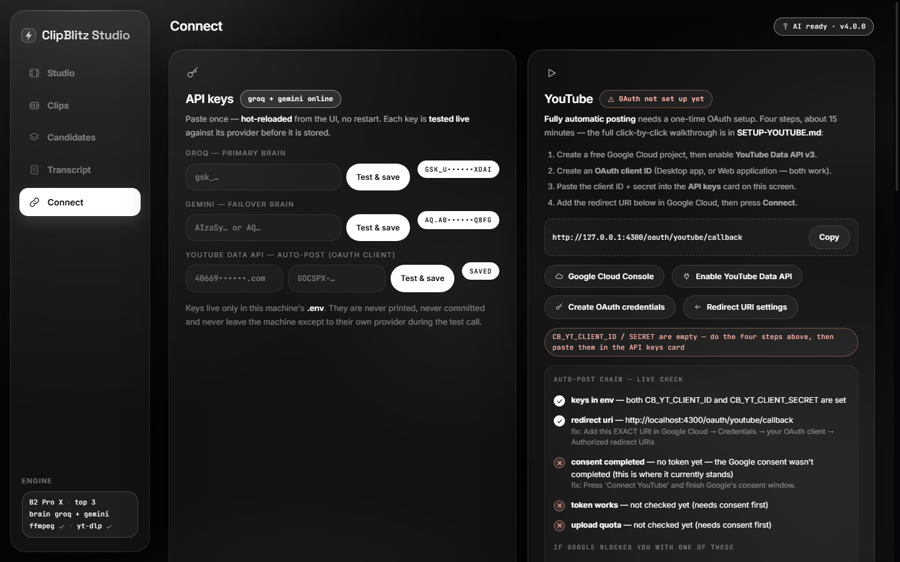
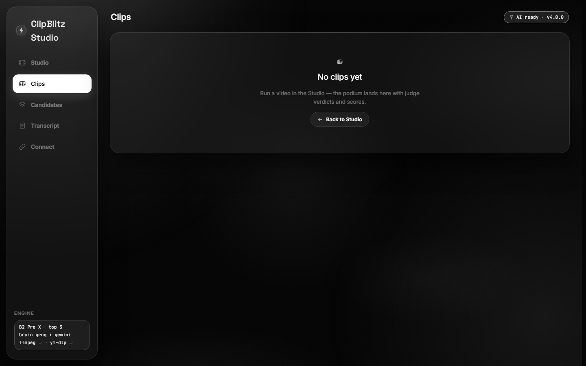

# ClipBlitz — AI Video Clipping Studio

<p align="center">
  
</p>

<p align="center">
  
</p>

<p align="center">
  <b>One long video in. The clips that matter out.</b><br />
  Your own OpusClip — self-hosted, zero watermark, zero monthly fees, honest scores.
</p>

<p align="center">
  <a href="https://github.com/agra-aarav15/clipblitz-ai-shorts/releases/tag/v5.2.0"><b>Download v5.2.0 Release</b></a> ·
  <a href="studio/SETUP.md"><b>Setup &amp; Phone Guide</b></a> ·
  <a href="BEGINNER-GUIDE.md"><b>Absolute Beginner Guide</b></a> ·
  <a href="SETUP-YOUTUBE.md"><b>YouTube Auto-Post</b></a>
</p>

---

## What is this

ClipBlitz is an AI-powered video editor that turns podcasts, interviews, gaming sessions, and long YouTube videos into viral, vertical shorts ready for YouTube Shorts, TikTok, and Instagram Reels.

Unlike tools that blindly split videos every 30 seconds, ARGON treats a clip as a complete
spoken unit with a measured opening and ending:

1. **Anchor graph** — spoken hooks, story arcs, self-summary lines, measured peaks and
   cinematic beats become candidate windows at several sentence-aligned lengths.
2. **Edge model** — measures the first sentence (dangling conjunction, fragment, mid-sentence
   start) and the ending (last word, next word, real pause). A cut through a word scores 0.15;
   continuous speech is not a pause; a finished sentence keeps 0.5-0.8s of room.
3. **Exact-transcript judge** — an independent LLM reads the exact cut, rates it and names
   concrete defects. It never invents a timestamp.
4. **Non-compensatory gate + repair** — a great hook cannot save a dead ending or a clip that
   needs earlier context. Repairs are deterministic and re-measured.
5. **Coverage-aware podium** — the judge sees one candidate per time slice, and only
   viral/strong cuts are published. Two strong clips beat three with filler.

---

## What's new in v5.2.0

- **One engine.** ProX v5, B2 Pro X, APEX and Both are retired from the UI, health payload
  and agent tools. Old jobs still load; every new job is ARGON.
- **Many providers.** Groq, Gemini, Cerebras, OpenRouter, Together, OpenAI, a no-key
  Pollinations fallback, and any local OpenAI-compatible server (Ollama). Multiple keys,
  ordered failover, cooldowns, 120s timeout. A 68-minute episode fell from 48.8 to 26.4
  minutes with transcript caching and parallel editor chunks.
- **Better coverage.** The judge pool guarantees one candidate per time slice; the podium
  no longer fills a third slot with a usable-but-flawed clip.

## What's new in v5.1.0

- **ARGON now scores both edges of a clip.** It measures the ending from the last word,
  the next word and the real pause between them; a cut through a word scores 0.15, a
  continuous next word does not count as a pause, and a finished sentence with room
  scores 0.78-1.0. It also labels a dangling opening ("But the main reason..."), a
  two-word fragment and a mid-sentence start, and repairs a weak opening to the previous
  or next complete sentence.
- **Self-summary lines** ("the point is", "the result was", "what I learned") are mined
  as payoff anchors, not only laughter and measured peaks.
- **Competitor study**: SupoClip's AGPL code was not copied; its boundary/opening ideas
  were independently implemented. AutoShorts is a generator, not a clip selector. The two
  Haris repositories are release-only, so only their README feature gaps were recorded.
  Details: `studio/docs/COMPETITOR-NOTES.md`.

## What's new in v5.0.2

- **Tail fallback edge case.** If commentary was continuous and the next word was longer
  than the 1.2s search window, the short fallback tail could land 0.1s inside that word.
  The tail now clamps to the next word's start. Covered by a regression test (71 ARGON
  checks). This is the only change from 5.0.1.

## What's new in v5.0.1

- **Endings breathe.** ARGON now walks to the first real pause after the last word and keeps
  0.8s of room (1.15s after a measured laugh) instead of trimming to 0.3s. It finishes a word
  that crossed the old cut, never chops the next syllable, and shortens the closing fade to
  0.12s. Measured on the F1 cuts: 0.53-0.80s tails instead of 0.29-0.36s. `CB_TAIL_PAD`
  changes the target.
- The Windows bundle uses the full BtbN ffmpeg with `libdav1d`, and YouTube ingest prefers
  H.264 at 1080p, so AV1 sources no longer stall the scene pass.

## What was new in v5.0.0

- **ARGON, one unified engine.** A four-channel anchor graph (spoken hooks, story arcs,
  measured peaks, cinematic beats), multi-scale sentence-aligned windows, 16 measured
  features, an exact-transcript retention judge, a non-compensatory ending/context gate, a
  deterministic repair loop, and MMR diversity. It became the only product engine in 5.2.0;
  ProX v5, B2 Pro X, APEX and Both are retired.
- **A judge that names the defect.** The LLM returns hook, payoff, emotion, shareability,
  rewatch, clarity, retention-at-3s, retention-to-end and concrete flags. It never invents a
  timestamp; it rates the exact final window.
- **The same honest box.** Rights gate, measured claim-risk report, licence record, edit
  receipt, clearance certificate, local learning loop, metadata-only Scout, ClipBench and the
  agent/MCP surface are unchanged. Nothing publishes without a human.

---

## ARGON, the unified engine (ClipBlitz Studio v5.2.0)

ARGON chooses the cut from spoken hooks, story arcs, self-summary lines, measured peaks and
cinematic beats. It is the only engine exposed in the UI, health payload and agent tools.
ProX v5, B2 Pro X, APEX and Both are retired; their source remains only as frozen reference
code so old jobs still load.

## Providers

ARGON runs offline without any key. When an editor/judge is available, the app uses an
ordered pool and fails over: Groq, Gemini, Cerebras, OpenRouter, Together, OpenAI, a no-key
**Pollinations** fallback, and any local OpenAI-compatible server (**Ollama/LM Studio** —
the permanent/free option). Multiple keys per provider, `CB_AI_ORDER`, 120s timeout and
provider cooldowns. Keys stay in `.env`; they are never sent to health, UI or logs. See
`studio/.env.example`.

## Works on any fresh PC — and on your phone

<p align="center">
  
  &nbsp;&nbsp;&nbsp;&nbsp;&nbsp;&nbsp;&nbsp;&nbsp;
  
</p>

- **One-click fresh-PC install:** `START.bat` checks for Python and installs it silently if missing. Bundled `ffmpeg` and `yt-dlp` ship inside the release zip — nothing else is downloaded.
- **Use it from your phone:** Open the printed `http://192.168.x.x:4300` address in your mobile browser. The computer does all the heavy video rendering; your phone controls the studio and previews the clips. Add to Home Screen for a native app feel.
- **Hardware-aware protection:** The host machine is measured (CPU cores, RAM, ffmpeg). Weak devices are told immediately: *"This device can't render clips. Use your laptop or PC to render them."* — avoiding mid-render crashes.

---

## Rights Guardrails — post what you have the right to post

ClipBlitz makes the safe path the easy path and makes a risky post loud. It never touches
content matching: there is no pitch shift, speed change, mirror or fingerprint trick anywhere in
the code, because those are circumvention — Content ID finds unlicensed re-uploads anyway, and
trying to dodge it is what gets channels terminated.

- **One-time rights gate.** Before the first automatic upload from a job, the Clips screen asks
  whether the material is your own, licensed, or a transformative fair-use edit, with an honest
  note on each. The answer is stored on the job and shown on it. Auto-post waits for it; the clip
  file is never withheld, so posting by hand stays the owner's call.
- **Source awareness.** A job started from a YouTube link records the uploader channel and video
  id (from the yt-dlp metadata the download already fetched) and shows them on every clip card,
  flagging the clip when that is not the channel you connected for posting.
- **Transformative-edit badge.** Rendered clips list the layers the render actually applied —
  captions burned into the picture, vertical reframing, the film grade, the J-cut — as one line,
  so a fair-use claim is anchored to something real and verifiable.
- **Claim-risk report.** What can honestly be measured before a clip goes anywhere: sustained
  non-speech audio outside the transcript (the shape of a music bed, theme or intro sting, with
  its timestamps), a source downloaded from a channel you may not own, an unrecorded or expired
  licence, and any clip carrying fewer transformative layers than the rest of the set.
- **Licence record and edit receipt.** `POST /api/job/<id>/licence` stores who granted what, with
  a reference and an expiry; `GET /api/job/<id>/receipt` writes the manifest — exact window of
  every cut, the engine that rendered it, the work that render applied, and sha256 hashes of the
  source and each output file. A claim is argued with paperwork, not with memory.

<p align="center">
  
</p>

Clipping **your own** long videos is always safe and is the primary use case. Other people's
material needs a licence or genuine fair use — and no tool can make somebody else's work
uncopyrighted, because a content-matching system matches the work itself. Full text:
**Copyright and strikes** in [studio/SETUP.md](studio/SETUP.md).

## A learning loop that stays on your machine

Every choice on a finished clip — posted, re-rendered from the Candidate Lab, hand-cut on the
Transcript timeline — is logged to a local `data/learning.json`, together with that clip's
measured factor breakdown and the candidate pool it was chosen from. Three layers learn from
those choices, each with its own evidence bar:

| Layer | Needs | Moves |
|---|---|---|
| Global taste | 10 choices | payoff / hook / pacing / story, up to **10% per factor** |
| Per engine | 15 choices **on ARGON** | ARGON only, up to 5% more, so the local model follows what you keep |
| Factor over-index | 8 choices that carried a candidate pool | the measured factor your kept cuts beat their own pool on, up to 6% |

Recent choices count more than old ones (half as much after 45 days), so the engine follows your
taste instead of being haunted by your first week. Below a threshold nothing moves, so a fresh
install ranks exactly like the shipped engine, and a `both`-engines run always scores on the
shared profile because one analysis pass has exactly one ranking. The Connect screen shows the
real counts, shares, medians and the plain-language *why* behind every multiplier in effect, with
a Reset button. No cloud, no external service, no extra scope on
the YouTube OAuth consent (`youtube.upload` cannot read Analytics, so view/retention feedback is
intentionally not pulled rather than silently widening what the app is allowed to do).

---

## Use it from an AI agent

The engine is not tied to the window. `studio/plugin/` is a plugin for an agent runtime —
Claude Code through its `--plugin-dir` flag, or any MCP client — and it exposes the same cuts
the app makes.

```
python -m clipblitz.agent cut episode.mp4 --clips 4 --json   # one shot, prints the clips as JSON
python -m clipblitz.agent risk <job_id>                      # what to check before publishing
python -m clipblitz.agent receipt <job_id>                   # write and show the edit receipt
python -m clipblitz.agent mcp                                # the MCP server itself, on stdio
```

Tools: `cut_clips`, `job_status`, `job_clips`, `risk_report`, `edit_receipt`, `learning_state`.
If a Studio is listening on `127.0.0.1:4300` the job goes through its own HTTP API — one writer
for `data/jobs.json`; if nothing is listening, the identical pipeline runs in-process. Either way
the agent feeds the same local learning store you train by hand. There is no publish tool: editing
is the plugin's job, and publishing stays a human decision made in front of the rights gate.

The ready-to-run Windows release carries `studio/plugin/` next to the EXE, and the EXE is the
same entry point, so the agent path needs no Python installed either: `ClipBlitzStudio.exe --mcp`
serves the identical MCP server on stdio, and `ClipBlitzStudio.exe --tools` prints the schemas.

---

## Quickstart

### Option A: Ready-to-run release (recommended)
1. Download **`ClipBlitzStudio-5.2.0-windows.zip`** from [Releases](https://github.com/agra-aarav15/clipblitz-ai-shorts/releases/tag/v5.2.0).
2. Unzip the folder anywhere.
3. Double-click **`START.bat`** (Windows) or run `bash start.sh` (macOS / Linux / Termux).
4. Open `http://localhost:4300` in your browser.

### Option B: Clone from source
```bash
git clone https://github.com/agra-aarav15/clipblitz-ai-shorts.git
cd clipblitz-ai-shorts/studio

# Fetch the bundled ffmpeg + yt-dlp (one time)
powershell -ExecutionPolicy Bypass -File scripts\fetch-tools.ps1   # Windows
bash scripts/fetch-tools.sh                                        # macOS / Linux

# Run the studio
python run.py                                                      # -> http://localhost:4300
```

Paste your free Groq key ([console.groq.com/keys](https://console.groq.com/keys)) into the **API keys** card, drop a video or paste a YouTube URL, and press **Edit my video**. No keys? Press **Demo video** for a generated end-to-end test run.

---

## Project Layout

```
studio/                 # Flagship ClipBlitz Studio (port 4300) — both engines, phone-ready
  run.py                # Studio server entry point
  START.bat             # One-click Windows launcher (silent Python install)
  start.sh              # macOS / Linux / Termux launcher
  clipblitz/            # Unified engine (pipeline, virality, cinema, rights, agent, server)
  web/                  # Obsidian Keynote UI (monochrome glass, PWA manifest, self-hosted fonts)
  plugin/               # Agent plugin: MCP server, /cut command, skill
  android/              # Android WebView companion app source
  SETUP.md              # Complete guide for fresh PCs, phones, and Termux
docs/shots/             # Unaltered, real screenshots of every screen
BEGINNER-GUIDE.md       # Zero-terminal guide for non-developers
SETUP-YOUTUBE.md        # YouTube Data API v3 OAuth walkthrough
```

---

## Technology

- **Backend:** Pure Python 3 standard library `ThreadingHTTPServer`. Zero pip packages required to run from source.
- **Frontend:** Pure HTML5, CSS3, vanilla JavaScript. Zero build steps, zero npm, zero external CDNs.
- **Typography:** Self-hosted `Inter`, `JetBrains Mono`, and `Space Grotesk` woff2 fonts.
- **Video:** Bundled `ffmpeg 9.0.1` and `yt-dlp`. Blur-pad 9:16 framing, ASS word-pop subtitle animations.
- **AI Dual-Brain:** Groq (`openai/gpt-oss-120b` or `llama-3.3-70b`) as primary brain + Google Gemini (`gemini-2.0-flash`) as automatic failover.

---

## License

MIT License. Free to use, modify, and self-host for personal and commercial projects.
